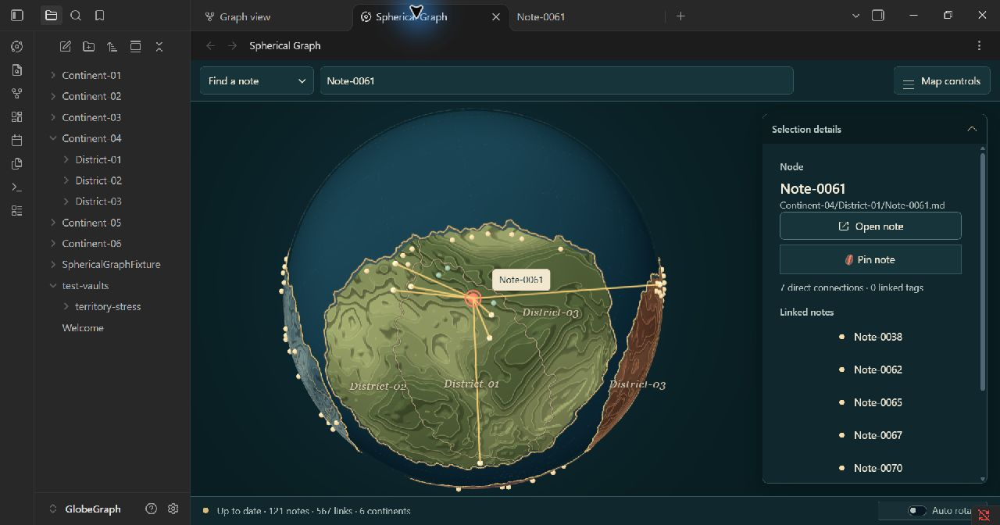

# Živá kartografie – třetí iterace podle jednotlivých nálezů

Implementováno a ověřeno 2. listopadu 2026 v nativním Obsidianu 1.14.5.
Podklad: koncept 3, druhý skutečný screenshot a následný seznam rozdílů.
Aktuální hodnoty jsou v JSON tokenech schemaVersion 3 a oddílu 27 specifikace.

## Zpracování nálezů

| Nález | Implementace | Ověření / hranice změny |
| --- | --- | --- |
| Plochý reliéf | Osm širších řezaných pater, tmavší stěny, osvětlené horní hrany a krátké statické stíny pod vyšší hranou. Dva dodatečné vzorky pole sledují kamerové světlo. | Skutečné nativní vykreslení, 0 chybných shaderů. Jde o optický materiál, fyzické body zůstávají na původním povrchu. |
| Rovnoměrné světlo | Ambient 0.46, key 0.64, zřetelnější horní levé světlo a protilehlý svah. Zesílení okrajové hloubky. | Stíny plynule nabíhají s detailem; přímý telefonní detail vynechává dva dodatečné vzorky. |
| Tlumené jednotné barvy | Sytější okr, hlubší jadeit, měděná hlína a větší rozsah nížina–plošina uvnitř jedné rodiny. | Rodiny zůstávají přiřazené původním colorIndex; nepřidělují se znovu kvůli kompozici ilustračního obrázku. |
| Nevýrazná města a výběr | Základ 8 px, minimum běžného města 6.5 px. Výběr má minimum 14 px, osvětlené jádro/hotspot, korálový prstenec a lokální 38px halo. Popisek volí stranu nebo místo nad/pod uzlem. | V běžícím rendereru naměřen průměr 14 px a aktivní hotspot. Popisek nepřekrýval střed vybraného města. Testuje se i uložené Globe size 155 %. |
| Slabé vztahy | Vybrané spojnice #F5CE76, 2 px, měkké 6px halo. Běžné vztahy jsou teplejší, jejich uživatelská opacity se zachovává. | Živé vybrané tahy mají 2 px. Wine Search, Route Finder, priorita a zoomové prahy zůstávají zachované. |
| Mechanické hranice | Zaoblení pouze kresby, maximální obálka 0.004 rad. Pevné junctions, ochrana měst 0.018 rad a veto při opuštění původní pevniny. Teplá 1.1px linka / 0.72 s tmavší 2.7px podkresbou. | Testy ověřují obálku, konce, poloměr, junctions a veto u města/pobřeží. Country borders v rendereru skrývá linku i podkresbu. Uložený raster je shodný. |
| Plochý oceán a tenké zubaté pobřeží | Hlubší modropetrolejová voda, směrové světlo a statická mikrostruktura. Jemná záře pozadí. Pobřeží: 1.5px zlatá linka, 3.4px tmavší podkresba a subpixelové zaoblení do 0.001 rad. | Dekorativní worker vrací samostatný coastInkPositions; původní coastPositions, land a beach buffery zůstávají dostupné. Podkresba mizí s kontinenty a při dispose se uvolní. |
| Výrazné názvy a hustý detail | Kontinent 15–19 px s lehčí vahou, země 13px kurzíva, více místa mezi sekcemi a sousedy. Open note je klidné orámované tlačítko s lokální SVG ikonou. | Nativní background tlačítka rgb(23,52,58); 36px desktop a 44px touch. Všechny sousední poznámky, tagy a akce zůstávají dostupné. |
| Jiná kompozice a geografie | Zklidněná hierarchie a světlo nad skutečnými daty. Zachované rámování podle detailu, boční/spodní panel a přístupné menu. | Makro tvary, mořské mezery, ostrovy a pozice nejsou přegenerované: platí původní požadavek zachovat uloženou mapu. Nevkládají se falešné ostrovy; nová geografie náleží explicitnímu Renew. |

## Skutečné snímky

Tyto soubory jsou přímé nativní screenshoty, nikoli generované vizualizace:

- [Výběr a detail](iteration-3-selection-native.jpg).
- [Přehled se skutečnými vztahy](iteration-3-overview-native.jpg).

Kontrolní výchozí mapa této iterace je
`layout-d0bd3911-80b6-43c8-89df-eea373554142`. Předchozí report popisoval
jinou identitu mapy, proto snímky různých iterací nejsou přesným geometrickým
diffem. Neměnnost se kontroluje proti stavu vaultu na začátku této iterace.
Při tomto ověření nebyl spuštěn Initialize, Refresh ani Renew.

## Nativní funkční a GPU kontrola

Dočasně pouze v rendereru byly vypnuty hranice, kontinenty, popisky a běžné
hrany; všechny odpovídající nové vrstvy se skryly. Původní appearance byla
obnovena. Dočasný satelit se dvěma členy ověřil i kompilaci satelitních shaderů:
0 chybných programů. Float32 pozice byly při testu přesně shodné.
Poté byl obnoven původní snapshot, počet tagů 0, a testovací globální
proměnná odstraněna.

Nativní DOM byl přeměřen při dočasných šířkách; původní styly/atributy byly obnoveny:

| Šířka | Simulovaný CSS profil | Přetékání view / toolbar | Vstup | Open note | Menu uvnitř view |
| --- | --- | --- | --- | --- | --- |
| 360 px | phone | 0 / 0 px | 16 px | 44 px | ano |
| 600 px | tablet | 0 / 0 px | 16 px | 44 px | ano |
| 900 px | desktop | 0 / 0 px | 13 px | 36 px | ano |
| 1440 px | desktop | 0 / 0 px | 13 px | 36 px | ano |

Přímé nastavení telefonního detailu ponechalo detailFade nejvýše 0.35 a
vypnutý rim, tedy bez dodatečných vzorků ledge shadow. Fyzický telefon/tablet,
srovnávací snímky při DPR 1/2 a dlouhodobý výkon velkého mobilního vaultu
nebyly měřeny na skutečných zařízeních.

## Uložená mapa a automatická brána

- SnapshotId i všech 121 cest zůstaly stejné.
- Kontinentový i country raster jsou shodné; finální centra kontinentů také.
- Max. rozdíl komponenty uložené pozice: 1.11e-16 z původní normalizace při načtení.
- Geografická data se kromě této existující normalizace nemigrují; obsah poznámek se nemění.
- `npm run check` s `VITEST_MAX_WORKERS=2`: 67 souborů, **414 testů úspěšně**,
  lint, typy, produkční build a validace vydání 1.10.1 úspěšně.
- `git diff --check` bez chyb. Vitest běžel mimo sandboxovou cache kvůli
  dříve ověřenému Windows EPERM; timeouty ani testovací limity se neměnily.

## Změněná implementační místa

- `src/render/terrainMaterial.ts`, `SphereLayer.ts`: terasy, světlo, voda, pozadí a geografické podkresby.
- `src/render/cartographicStroke.ts`, `landGeometry.ts`, `land-worker-entry.ts`: chráněná kresba hranic a samostatná kresba pobřeží.
- `src/render/cityMaterial.ts`, `NodeLayer.ts`: jádra a dominantní výběr.
- `src/render/LabelPlacement.ts`, `LabelLayer.ts`: umístění popisků.
- `styles.css`, `ziva-kartografie.tokens.json`: paleta, rozměry, typografie, detail a ikona.
- `tests/render/cartographicStroke.test.ts`, `cartography.test.ts`, `NodeLayer.test.ts`,
  `SphereLayer.test.ts`, `countryPresentation.test.ts`: nové a rozšířené regresní kontroly.
- Specifikace, design-system, rozhodnutí a implementační plán: aktuální pravidla a ověření.

Číslo verze zůstává 1.10.1. Lokální plugin je sestavený a načtený v Obsidianu;
tato iterace nepublikuje vydání ani nevytváří commit.
