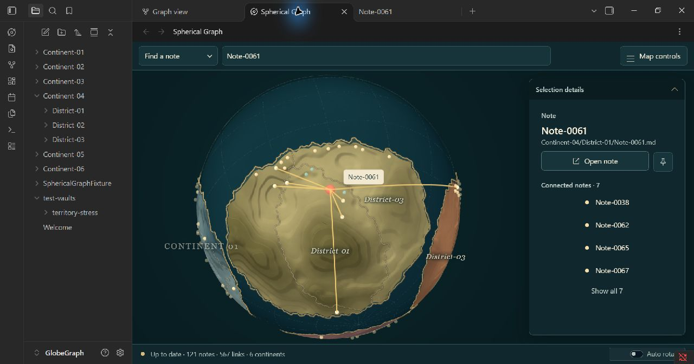

# Živá kartografie – čtvrtá iterace a nové porovnání

Implementováno 2. listopadu 2026. Podklad: původní koncept 3, skutečné
snímky třetí iterace a všech devět následných vizuálních nálezů.
Aktuální hodnoty: tokeny schemaVersion 4, specifikace oddíl 28.

## Nálezy zpracované bod po bodu

| Nález | Provedená změna | Ověření |
| --- | --- | --- |
| Vyryté drážky místo vrstevnatého materiálu | Spojité širší svahy se míchají s šesti terasami. Vyšší prostorové frekvence mají výrazně menší vliv na normály; jemný materiálový reliéf a zrno jsou samostatné. První nativní náhled byl ještě důlkovaný, proto byly váhy pole znovu upraveny. | Nový skutečný snímek; shader nemění fyzické souřadnice. |
| Zářící hrana každého patra | Světlý lip se násobí druhou mocninou směrového osvětlení; tmavá stěna patří odvrácené straně. Výrazně menší intenzita celoplošného obrysu. | 0 chybných shaderových programů v nativním WebGL. |
| Státy splývají s vrstevnicemi | Plošné odstíny podle skutečného country rasteru, stále uvnitř původní barevné rodiny. Teplá 1.1px hranice a tmavší podkresba zůstávají. | GPU atribut countryTone −0.11 až +0.09 na aktuální mapě. Test mapování, moře a neměnnosti vstupů. |
| Výběr vypadá jako korálový kroužek | Vyplněné 17px korálové jádro, teplý hotspot, 42px halo; primární prstenec zeslaben na 40 %. Nezávislý Search halo/stav není zeslaben. | V běžícím rendereru průměr 17 px, coreOpacity 1 a hotspot 1. Regrese stavů v NodeLayer. |
| Hustá pavučina v přehledu | Běžné dlouhé, mezikontinentální a hubové vztahy mají nižší pozitivní koeficient opacity. Počet vztahů a segmentů zůstává zachován. Vybrané, hover, Search a route tahy používají plnou stavovou sílu. | 567 viditelných edge records; koeficienty aktuální běžné kresby 0.28–0.975. Test ověřuje zachované segmenty a plnou vybranou vrstvu. |
| Hladký modrý oceán | Hlubší petrolejové barvy, matná statická textura. Čitelnější čárkovaná síť 0.65 px / 0.28; hustší geometrie sítě brání propadání úseček pod hloubkovou masku. | Nativní přehled, stejné šířky a opacity přečtené z GPU uniformů. Síť leží pod pevninou. |
| Jednotné zlaté pobřeží a perlový náhrdelník | Pobřežní ink dostává směrové světlo. Běžná města u obzoru se plynule tlumí až na 40 %; výběr a další důležité stavy zůstávají čitelné. | Nativní snímek a test opacity včetně plného vybraného jádra. Žádné město není přesunuto. |
| Dominantní olivová plocha a prázdný mořský vršek | Teplejší sage paleta. Explicitní Find/Focus bere část plošného středu uloženého kontinentu, nejvýše 0.24 rad od města. Střed se odvozuje z území, nikoli ze shluku pobřežních uzlů. | Dva testy: omezení úhlu, skutečný raster proti nesprávnému seedu a neměnné vstupy. Obyčejný výběr ani hover kameru neotáčí. |
| Přeplněný detail a málo místa kolem názvů | Open note a ikonový Pin v jednom řádku, vynechaná prázdná metadata, čtyři sousedé v náhledu a přístupné Show all N. Lokální měkké ztmavení pod geografickými názvy. | Skutečným klikáním ověřeno 4 → všech 7 → 4; Pin má přístupný název. Nativní DOM kontrola čtyř šířek. |

## Nové skutečné snímky

Nejde o generované ilustrace ani o testovací geometrii. Jsou to přímé
screenshoty Obsidianu 1.14.5, okno 1280 × 672 px:

- [Vybrané město a detail](iteration-4-selection-native.jpg).
- [Přehled bez výběru](iteration-4-overview-native.jpg).
- [Původní vizualizace](03-ziva-kartografie.png), 1536 × 1024 px.

## Nové porovnání s původní vizualizací

**Hierarchie je bližší návrhu:** korálový výběr má viditelnou výplň a okolní
světlo, vztahy výběru jsou teplé zlaté a výraznější než geografická kresba.
Detail má čistší akční řádek a menší množství okamžitě zobrazeného obsahu.
Státy odlišuje vedle linky i plošný tón. Oceán má čitelnější síť a méně
modrý odstín. Reliéf má širší svahy a méně stejně silných drobných důlků.

**Největší zbývající rozdíl je materiál pevniny.** Koncept má mnohem jemnější,
nepravidelný erodovaný povrch a husté vrstvy se skutečně působícími přesahy.
Aktuální široké terasy jsou místy příliš oblé a hladké; mohou připomínat
vosk. Směrové světlo potlačilo falešný celoplošný emboss, ale výsledek ještě
nemá stejnou hmatatelnost jako výtvarný referenční obrázek. Optický shader
nemění siluetu ani fyzickou výšku povrchu.

**Hranice jsou čitelnější, plošné rozdíly stále jemnější než v konceptu.**
Referenční státy mají výraznější hnědé/okrové oblasti a více nepravidelných
detailů. Naše linka místy stále prozrazuje rozlišení původního rasteru.
V této iteraci se neměnila geometrie vlastnictví.

**Přehled je klidnější, ale u hubů zůstává hustší.** Reference ukazuje
ilustračních 228 vztahů; skutečná mapa jich zobrazuje 567. V přehledovém
snímku je stále patrné sbíhání mnoha spojnic do pobřežních měst. Vybraný
stav je výrazně čistší. Ztlumení kontextu nezamlčuje existenci vztahů.

**Oceán a pobřeží jsou stále jednodušší.** Koncept má jemnější minerální
mikrostrukturu vody, rozmanitější pobřežní materiál a množství malých ostrovů.
Nativní voda zůstává hladší; zlatá pobřežní linka je i po směrové modulaci
graficky pravidelnější. Pobřežní města jsou tišší, jejich shluky jsou však
dané uloženou mapou a zůstávají viditelné.

**Kompozice se nemůže shodovat při zachování této mapy.** V konceptu dominuje
okrový kontinent s jadeitovým a korálovým sousedem; tento uložený pohled má
velkou sage/olivovou pevninu, menší boční území a mořský vršek. Teplejší
paleta a omezený posun explicitního focusu to zmírňují, velké plochy ale
nepřemalovávají na jinou rodinu. Názvy jsou skutečné Continent/District
a detail má čtyři sousedy plus Pin, zatímco ilustrace používá obsahové názvy
a tři sousedy. Menší viewport a okolní Obsidian UI také mění celkový dojem.

## Nativní funkční a GPU kontrola

- 0 chybných WebGL programů včetně dočasného stříbrného satelitu a jeho
  spojnic. Testovací tag existoval pouze v rendereru; původní snapshot i
  jeho 0 tagů byly obnoveny a testovací globální proměnná odstraněna.
- Renderer obsahuje 122 vstupních uzlů / 568 hran včetně jednoho
  unresolved uzlu; stávající filtr vykresluje 121 poznámek / 567 vztahů.
  Nové kontextové zeslabení žádný další vztah neodstraňuje.
- Dočasné vypnutí hranic, kontinentů, hran a popisků skrylo odpovídající
  vrstvy včetně coastShadow a countryBorderShadow. Appearance byla obnovena.
- Při dočasném QA zůstaly Float32 pozice rendereru přesně shodné.
- Telefonní detail měl maximum 0.35 a rim byl vypnutý. Dva dodatečné
  ledge-shadow vzorky jsou pod svým prahem. Fyzická mobilní zařízení,
  DPR 1/2 a dlouhodobý výkon velkého vaultu zde měřeny nebyly.

Původní DOM styly, device profil a stav menu byly po měření obnoveny:

| Šířka | CSS profil | Přetékání view / toolbar | Vstup | Open / Pin | Akce a menu uvnitř |
| --- | --- | --- | --- | --- | --- |
| 360 px | phone | 0 / 0 px | 16 px | 44 / 44 px | ano |
| 600 px | tablet | 0 / 0 px | 16 px | 44 / 44 px | ano |
| 900 px | desktop | 0 / 0 px | 13 px | 36 / 36 px | ano |
| 1440 px | desktop | 0 / 0 px | 13 px | 36 / 36 px | ano |

## Zachování uložené mapy

Porovnání skutečného data.json s kopií před touto iterací:

- snapshotId `layout-d0bd3911-80b6-43c8-89df-eea373554142` shodné;
- všech 121 uložených cest, graphDescriptor a renewGeneration shodné;
- území/country raster a geografická metadata přesně shodné; po závěrečném
  reloadu je jediný rozdíl geografie v centru jednoho kontinentu, nejvýše
  1.11e-16 z existující normalizace při načtení;
- max. rozdíl komponenty uložené pozice po závěrečném reloadu 2.22e-16,
  rovněž z existující normalizace, nikoli z nového rozložení;
- Initialize, Refresh ani Renew nebyly při QA spuštěny. Obsah poznámek
  ani solver nebyly měněny.

## Automatická brána a změněná místa

`npm run check` s `VITEST_MAX_WORKERS=2` prošel: lint, typová kontrola,
**418 testů v 69 souborech**, produkční build a release validation 1.10.1.
`git diff --check` bez chyb. Vitest běžel mimo Windows sandbox kvůli jeho
ověřenému omezení zápisu SSR cache; testovací timeouty se neměnily.

První úplný běh odhalil použití nepovoleného clip-path pro skrytý popisek
Pin (417 testů prošlo, 1 selhal). CSS bylo nahrazeno podporovaným clip rect;
finální úplný běh už prošel celý. Přístupný název tlačítka zůstává zachovaný.

Nové moduly: countryTone.ts a roadEmphasis.ts. Úpravy: terrainMaterial,
SphereLayer, cityMaterial, NodeLayer, EdgeLayer, screenSpaceLine, LabelLayer,
cameraFraming, SphericalGraphRenderer, landGeometry/worker,
SelectionDetailsPanel, styles.css a sdílené tokeny. Přidány/rozšířeny testy
mapování country tónů, zachovaných hran, focusu nad skutečným územím
a opacity měst. Specifikace, design-system, rozhodnutí a plán jsou aktualizované.

Číslo pluginu zůstává 1.10.1. Lokální build je načtený v Obsidianu;
tato iterace nevytváří commit ani nepublikuje vydání.
