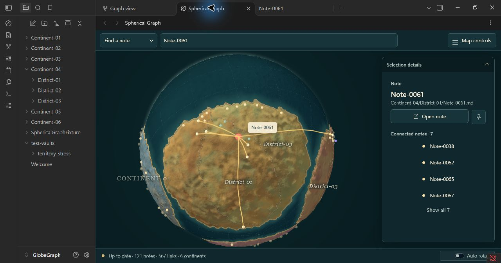

# Živá kartografie – tři kroky prostorové iterace

Dokončeno 2. listopadu 2026 v lokálním Spherical Graph 1.10.1.
Podklad: původní koncept 3 a následná analýza materiálu, reliéfu, oceánu,
atmosféry, pobřežního přechodu a zakřivených vztahů. Uživatel výslovně
schválil skutečnou výšku vykreslovaného terénu a odlišnou barvu špendlíku.
Aktuální specifikace: oddíl 29, tokeny schemaVersion 5.

## Krok 1 – materiál, světlo, oceán a atmosféra

- Každá kontinentová rodina má vedle základu/shadow/highlight tři minerální
  barvy. Nepravidelné zlaté, hnědé, zelenější či měděné oblasti mají vlastní
  prostorové pole, nezávislé na osvětlení a výškových patrech.
- Státy dostávají jemný posun do příbuzného minerálního odstínu podle
  skutečného country rasteru, nikoli jen rozdílný jas.
- Jednotný key ze směru normalize(−0.60, 0.76, 0.38), ambient 0.38, key 1.0.
  Pevnina, pobřežní stěny/pás, geographic ink a voda sdílejí směr světla.
- Oceán má statický optický reliéf, jemnou strukturu a světlejší petrolejové
  mělčiny podle skutečné vzdálenosti pobřeží. Nová waterShallow atributová
  vrstva má na této mapě hodnoty až 1. Při skrytí kontinentů se vypne.
- HorizonGlow přidává měkký 6px atmosférický okraj mimo siluetu a stávající
  1.2px vnitřní lem. Světlo slábne směrem k odvrácené straně. Na telefonu
  má vnější okraj 4 px. Stávající volitelné mraky zůstávají samostatné.
- Hlavičky fyzických špendlíků jsou **#A58AFF**, nožky **#F5FAFC**. Hlavička
  má poloměr 0.10 před existujícím škálováním Globe size. Barvy jsou nezávislé
  na městě i na výběru. Připnuté tlačítko Pin má také fialový stav.

## Krok 2 – skutečný reliéf a společné kotvení

TerrainSurface vytváří deterministické pole nad původní podporou pevniny.
Širší svahy a deformované hřbety se míchají s deseti měkce řezanými patry.
Vysoké frekvence mají menší geometrický vliv; těsné okolí měst se zklidňuje.
Při prvním nativním náhledu bylo optické zrno příliš silné, proto byla jeho
normálová síla snížena z 0.24 na 0.035 a zvýšen podíl širších tvarů.

Worker zachovává původní land/beach/coast buffery a přidává oddělené odvozené
pozice, normály, výšky, pobřežní stěny a vyvýšenou geografickou kresbu.
Ve skutečném rendereru bylo naměřeno:

| Vlastnost | Nativní hodnota |
| --- | --- |
| Základní poloměr | 10 |
| Poloměr nejnižšího / nejvyššího vrcholu pevniny | 10.00250 / 10.22250 |
| Maximální výška nad původním land offsetem | přibližně 0.22 = 2.2 % R |
| Vrcholy pevniny | 71 286 |
| Vrcholy skutečných pobřežních stěn | 11 784 |
| Města skrytá pod terénem při radiální kontrole | **0** |

Stejný sampler kotví města, piny, geografické hranice a názvy, počátky
satelitních spojů a cesty. Výšky jsou odvozená vykreslovací data; uložený
jednotkový směr uzlu se nikdy nepřepisuje. Cache je omezena na 65 536 výšek
na připravený snapshot. Původní tag orbit 33 % a uživatelské Globe size 105 %
zůstaly zachované.

Pobřežní pás přechází z nižší písečné plochy do skutečné boční stěny vyvýšené
pevniny. Stěna dostává směrové světlo a kontaktní ztmavení u paty. Vnitřní
materiál má jemné cavity stínování. Picking a DOM popisky testují skutečnou
geometrii. Toto není globální realtime shadow mapa; neověřujeme zde fyzikálně
přesné vržené stíny celé planety.

## Krok 3 – zakřivené vztahy a čitelnost

Vztahy dostaly mírný boční ohyb přímo po S²: nejvýše 3.5 % úhlové délky,
s limitem 0.025 rad. Konce zůstávají na původních městech; kanonické ID dvojice
zajišťuje stejný výsledek při obrácení vztahu, rotaci i zoomu. Blízkost cizího
města vetuje ohyb. Radiální kotvení a kontrolní vzorky zajišťují odstup od
terénu a korekci spojovacích úseček. Vybrané, hovered, Search a route vrstvy
přebírají stejnou geometrii a dosavadní sílu/prioritu.

Stávajících **567 viditelných vztahů** zůstalo zachovaných. Vstupní snapshot
obsahuje 122 uzlů / 568 hran včetně jednoho unresolved uzlu; původní filtr
zobrazuje 121 poznámek / 567 vztahů. Nový vzhled neodstraňuje další vztahy.

## Skutečné snímky a nové porovnání

Přímé nativní screenshoty Obsidianu 1.14.5, okno 1280 × 672 px:

- [Výběr a detail](iteration-5-selection-native.jpg).
- [Přehled bez výběru](iteration-5-overview-native.jpg).
- [Existující uložený špendlík](iteration-5-pin-native.jpg).
- [Původní vizualizace](03-ziva-kartografie.png), 1536 × 1024 px.

**Barevnost je nyní pestřejší.** Na předním kontinentu jsou vidět teplejší
okrové a hnědé oblasti i zelenější skvrny. Jde o změny materiálu, nikoli
pouze světlo/stín. Předloha však stále má větší a lépe komponované barevné
oblasti, výraznější tmavě hnědé státy a méně drobného mramorování.

**Reliéf už je skutečný, jeho charakter zůstává odlišný.** Při otáčení
ovlivňuje výšku a siluetu, pobřeží má tloušťku. Na novém snímku převládají
širší oblé kopce a hřbety. Předloha má jemnější rozvětvené erodované vrstvy,
ostřejší drobné přesahy a více čitelných řezů. Nové provedení tedy není
vizuálně totožné s ilustrací; největší zbývající rozdíl je právě tvar terénu.

**Oceán a vnější okraj jsou bližší předloze.** Voda má strukturu a světlejší
pobřežní mělčiny; horní levý obrys odděluje měkké atmosférické světlo.
Na předloze je nejjasnější lem teplejší a místy ostřejší, zatímco nový lem
je chladnější a měkčí. Naše voda má pravidelnější procedurální strukturu.

**Světlo je více boční a horní.** Odvrácené svahy jsou tmavší, horní levé
hrany světlejší. Předloha stále působí jako detailnější materiál se složitějšími
lokálními stíny. Současné stínování je lokální a cíleně levnější.

**Pobřežní přechod má nový materiálový význam.** Mezi pevninou a pískem je
geometrická stěna, vedle ní petrolejová mělčina. Reference má více rozmanitých
útesů a přechodů po délce pobřeží; naše kresba je místy pravidelnější.

**Vztahy jsou jemně prohnuté a špendlíky rozlišitelné.** Ohyb je záměrně
malý, hlavně u krátkých vztahů. Fialová hlavička se odlišuje od světlého města,
korálového výběru i zlaté trasy. Přehled zůstává hustší než ilustračních
228 vztahů a u skutečných hubů je patrné sbíhání cest.

**Geografie a kompozice zůstávají jiné.** Zachovaná mapa má šest kontinentů,
velkou přední pevninu a mořský vršek. Předloha má odlišné tvary, ostrovy,
barevné rodiny v jiném pořadí a obsahové názvy. Tyto prvky se nepřegenerovaly.

## Nativní funkční kontrola

- Find vyhledal a zaměřil Note-0061; výběr, sousedé a detail zůstaly čitelné.
- Fyzické piny: počet 2, barvy GPU materiálů a58aff / f5fafc. Druhý snímek
  výběru ukazuje již existující připnutou Note-0029, bez změny uložených pinů.
- Dočasná kombinace satelitu, dvoubodové trasy, Search a výběru:
  tagLinks true, routeRibbon true, 2 nezávislé Search rings,
  **0 chybných shaderových programů**. Float32 pozice přesně shodné.
- Původní snapshot, tagy 0, Search, route, appearance a viditelnost tagů byly
  obnoveny. Testovací globální proměnná odstraněna.
- Vypnutí kontinentů skrylo pevninu, stěny, hranice/podkresby, vypnulo mělčiny
  a vrátilo výšky měst na R + 0.08. Hidden také skryl atmosférický lem.
- Transparent: landDepth false, wallDepth false, wallAlpha 0.3, vnější lem
  vypnutý. Po kontrole obnoveno Solid.
- Telefonní detail: land 0.35, water 0.35, vnější lem 4 px; dva dodatečné
  vzorky vodního reliéfu jsou pod svým prahem a neprovádějí se.

Původní DOM styly, device profil a stav menu se po měření obnovily:

| Šířka | CSS profil | Přetékání view / toolbar | Vstup | Open / Pin | Menu a Pin uvnitř |
| --- | --- | --- | --- | --- | --- |
| 360 px | phone | 0 / 0 px | 16 px | 44 / 44 px | ano |
| 600 px | tablet | 0 / 0 px | 16 px | 44 / 44 px | ano |
| 900 px | desktop | 0 / 0 px | 13 px | 36 / 36 px | ano |
| 1440 px | desktop | 0 / 0 px | 13 px | 36 / 36 px | ano |

## Uložená mapa a automatická brána

Porovnání s kopií skutečného committedLayout před touto iterací:

- snapshotId layout-d0bd3911-80b6-43c8-89df-eea373554142 shodné;
- všech 121 uložených cest, graphDescriptor, seed, generace i completedAt shodné;
- území/country raster, ostatní geografie a centra kontinentů přesně shodné;
- maximální rozdíl uložené komponenty pozice **0**, rozdíl centra **0**;
- po nativní QA shodné settings a pinnedNotePaths. Žádný Initialize,
  Refresh ani Renew, žádné změny obsahu poznámek.

Finální `npm run check` s `VITEST_MAX_WORKERS=2` prošel: lint, typy,
**427 testů v 71 souborech**, produkční build a release validation 1.10.1.
Testy pokrývají nové skutečné výšky/okluzi, neměnnost původních bufferů,
výškové přepínače, kontrast pinů, konečné/opačné/antipodální křivky,
ochranu cizích měst, odstup úseček a zákaz výběru města zakrytého terénem.
Časové limity se nezvyšovaly. Geometrický test používá menší síť, aby
ověřoval chování nezávisle na zatížení GUI a desktopovém rozlišení.

Fyzický telefon/tablet, DPR 1/2 a výkon velmi velkých vaultů nebyly měřeny.
Nativní kontrola platí pro tuto skutečnou mapu a místní hardware.

Nové moduly: terrainSurface, reliefGeometry, surfaceRoad a HorizonGlow.
Upraveny materiály, renderovací vrstvy, picking, land worker, společné tokeny,
Pin CSS, testy a návrhová dokumentace. main.js je lokálně sestavený a načtený.
Verze zůstává 1.10.1; nebyl vytvořen commit ani publikováno vydání.
