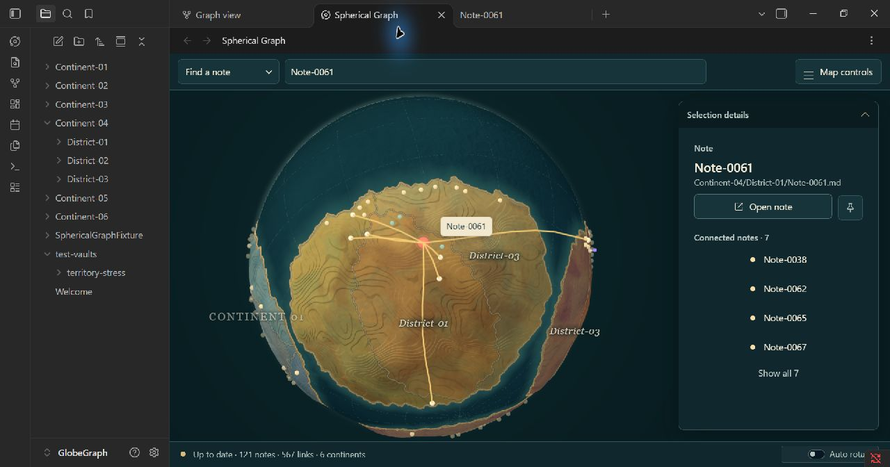

# Živá kartografie – ostřejší reliéf, odstíny států a jeden hover popisek

Dokončeno 3. listopadu 2026 v lokálním Spherical Graph 1.10.1.
Reference: koncept 3 a skutečný snímek páté iterace. Aktuální specifikace
je oddíl 30, tokeny schemaVersion 6.

## Provedené změny

**Reliéf:** 16 jemnějších pater, 94 % terasové složky a 6 % spojitého svahu.
Stěna zabírá užší fázi 0.41–0.59. Širší prostorově deformované pole vytváří
delší souvislé vrstvy; vysoké frekvence mění jejich okraje. První náhled s
drobnými hřbety zůstal příliš hrbolkatý, proto bylo pole znovu upraveno.

Síť se zjemňuje u přechodů a dělí přímo na začátcích/koncích pater. Plošiny
mají hladké radiální normály, úzké stěny oddělené normály skutečných ploch.
Společné hrany sousedních trojúhelníků se dělí shodně. Hrubší zdrojové sítě
používají konzistentně méně geometrických řezů. Maximální výška a společné
kotvení měst, pinů, hran a popisků zůstávají zachované.

Jemné normálové zrno má sílu 0.012; směrové stěny/lipy se filtrují podle
pixelové velikosti. Výpočet detailu nyní používá skutečný promítnutý průměr
glóbusu. Materiál tak lépe odděluje plochu patra od úzkého přechodu.

**Státy/podadresáře:** vlastní jemný RGB násobitel podle country klíče.
Teplejší, olivový či chladnější nádech má podobný jas a zachovává barevnou
rodinu kontinentu. Odstíny jsou stabilní při změně pořadí klíčů a vycházejí
ze skutečného country rasteru, případně z existující legacy display vrstvy.
Nejde o nové vlastnictví ani o náhodné skvrny místo států. Síla zelených a
drobných minerálních skvrn byla zklidněna, aby plošné odchylky nezanikaly.

**Hover:** pokud už město identifikuje viditelný mapový popisek, samostatný
tooltip se nezobrazí. Kontrola po umístění popisků zruší i čekající druhý
tooltip. Při vypnutých nebo neumístěných mapových popiscích zůstává náhradní
tooltip pouze s názvem. City labels už nemají title s adresářovou cestou.
Tagové tooltipy, výběr, otevírání poznámek a ovládání dotykem zůstávají.

## Výkon zákrytu hustší sítě

První nativní měření nad novou sítí ukázalo přibližně 18.1 ms na jeden
původní brute-force dotaz zákrytu. To by zpomalovalo popisky i hover.
Worker proto sestavuje kompaktní BVH index nad skutečnými trojúhelníky.
Přesné front-face průsečíky a odstup před koncovým bodem zůstávají zachované.
Test porovnává index s původním Three.js raycastem včetně osových paprsků.

Orientační měření stejného dotazu po zahřátí na místním stroji: průměr
**0.985 ms** z 20 dotazů. Nejde o benchmark FPS ani záruku pro jiná zařízení.
Index se uvolní s geometrií, nepřidává závislost ani data do uložené mapy.

## Skutečné snímky a nové porovnání

Přímé screenshoty Obsidianu 1.14.5, okno 1280 × 672 px:

- [Nový výběr a detail](iteration-6-selection-native.jpg).
- [Nový přehled](iteration-6-overview-native.jpg).
- [Předchozí iterace](iteration-5-selection-native.jpg).
- [Původní vizualizace](03-ziva-kartografie.png), 1536 × 1024 px.

**Proti páté iteraci:** oblé drobné kopce ustoupily souvislejším plošinám
a úzkým, čitelným stupňům. Hrany pater mají výraznější zalomení. Na předním
kontinentu lze přes původní hranice rozlišit zelenější levý stát, teplejší
prostřední a chladnější/tlumenější pravý. Odchylky jsou záměrně malé a stále
působí jako jeden kontinent. V hoveru zůstává jediný název bez adresáře.

**Proti původní vizualizaci:** členění vrstev je nyní podstatně bližší,
ale stále pravidelnější a více vrstevnicové. Předloha má organičtější,
jemně erodované hrany, drobné zářezy, nepravidelné přesahy a bohatší
mikrostrukturu. Naše některé vrstevnice zůstávají hladší a delší. Nejde
o vizuálně totožnou rekonstrukci ilustračního obrázku.

Předloha rozlišuje některé státy výraznějšími hnědými/okrovými oblastmi;
naše nádechy jsou jemnější podle nynějšího požadavku. Geografická hranice
se kreslí původním teplým inkem a není nahrazena barevným rastrem.

Oceán, atmosférický lem, vyplněný korálový výběr, zakřivené vztahy a fialové
špendlíky z předchozí iterace zůstaly. Přehled má stále více skutečných vztahů
než reference (567 proti ilustračním 228). Tvary kontinentů, ostrovy a velký
mořský vršek patří uložené mapě a nebyly přegenerované.

## Nativní funkční a GPU kontrola

| Kontrola | Výsledek |
| --- | --- |
| WebGL programy včetně satelitní a stavové kombinace | **0 chybných** |
| Vrcholy nové vykreslované pevniny | 842 532 |
| Min./max. poloměr pevniny | 10.00250 / 10.22250 při R = 10 |
| Města skrytá pod terénem při radiální kontrole | **0** |
| Viditelné vztahy / uložené piny | 567 / 2 |
| Barva hlaviček pinů | a58aff |
| Společná kombinace tag linků, trasy a Search | linky i trasa aktivní, 2 Search rings |
| Float32 pozice během dočasné QA | přesně shodné |

Hover byl ověřen skutečným event řetězcem PointerEvent v nativním canvasu
s čekáním 350 ms: jeden viditelný mapový popisek `Note-0061`, title null,
samostatný tooltip skrytý. Po dočasném vypnutí mapových popisků se zobrazil
jen fallback `Note-0061`. Po obnovení byl fallback opět skrytý. Adresářová
cesta zůstává dostupná v detailu poznámky, ne ve druhém hover popisku.

Vypnutí kontinentů skrylo pevninu, stěny a hranice a vypnulo jejich zákryt.
Telefonní detail: land 0.35, water 0.35, vnější lem 4 px. Dočasný tag,
trasa, Search a appearance byly obnoveny; QA globální proměnná odstraněna.

## Zachování mapy a automatická brána

- Celý committedLayout se shoduje s kopií před touto iterací.
- SnapshotId layout-d0bd3911-80b6-43c8-89df-eea373554142, všech 121 cest,
  geografie/country raster, centra, seed i generace zůstaly zachované.
- Maximální rozdíl uložené souřadnice **0**. Settings i pinnedNotePaths shodné.
- Nebyl spuštěn Initialize, Refresh ani Renew; obsah poznámek se neměnil.
- `npm run check`, VITEST_MAX_WORKERS=2: **433 testů v 73 souborech úspěšně**,
  lint, typy, produkční build a release validation 1.10.1 úspěšně.
- `git diff --check` bez chyb. Testovací timeouty se nezvyšovaly.

Nové testy ověřují ploché části a úzké risery, spojité společné hrany,
rozměry všech atributů po zjemnění, stabilní odstíny států, potlačení čekajícího
dvojího tooltipu i fallback a přesnost prostorového indexu proti raycastu.
Fyzický telefon/tablet, DPR 1/2 a velmi velké vaulty nebyly nově měřeny.

Změněná místa této iterace: terrainSurface, reliefGeometry, terrainMaterial,
countryTone, SphereLayer, landGeometry/worker, LabelLayer, PickingController,
SphericalGraphRenderer, tokeny a testy. Nový modul terrainOcclusion obsahuje
workerový index. Verze zůstává 1.10.1; lokální build je načtený v Obsidianu.
Tato iterace nevytváří commit ani nepublikuje vydání.
